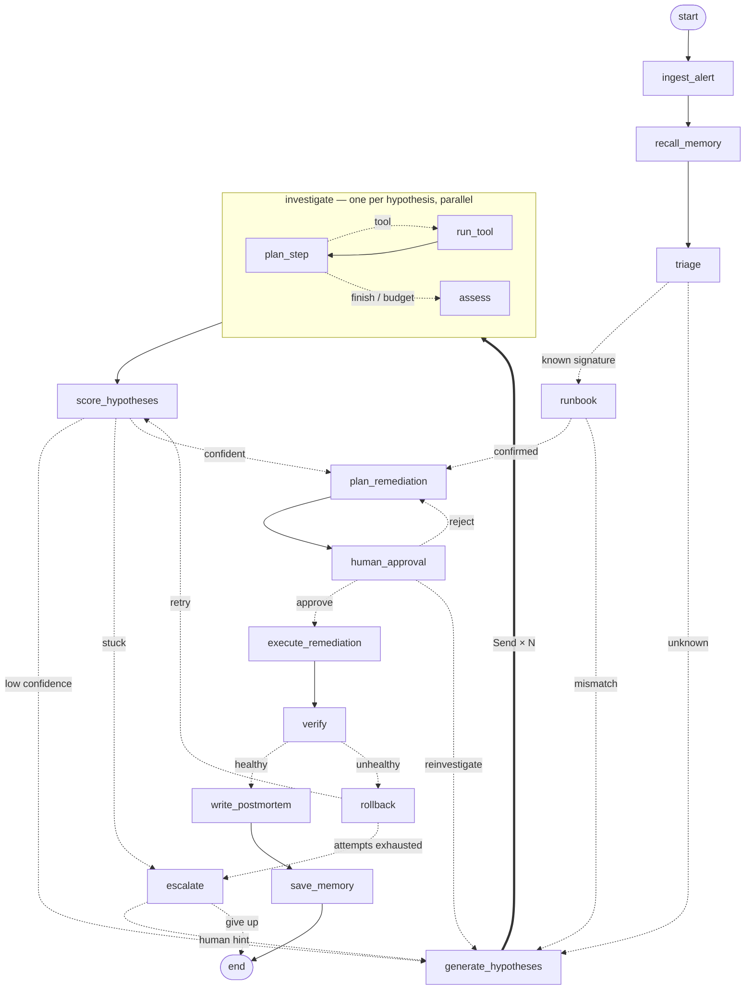

# SRE Incident Agent (LangGraph)

An autonomous on-call engineer. An alert fires; the agent triages it, checks
long-term memory for a known failure signature, generates competing root-cause
hypotheses, investigates them **in parallel** with tool-using subagents,
correlates the evidence, proposes a fix, **pauses for human approval**, applies
it, verifies recovery, **rolls back and re-diagnoses** if the fix didn't work,
and finally writes a postmortem and remembers the incident for next time.

It runs against a **simulated production environment** driven by scenario files
(services, deploys, logs, metrics, traces, Kafka lag, pod state), each with a
hidden root cause, red herrings, and remediation actions that fix, fail, or make
things worse.

## Why this is a graph and not a chain

| LangGraph feature | Where it's used |
|---|---|
| Dynamic fan-out with `Send` | One investigator subgraph per hypothesis, all running in parallel |
| Fan-in + custom reducers | `merge_by_id` lets parallel branches update their own hypothesis/evidence records without clobbering each other |
| Subgraphs with private state | `investigator` (plan → tool → plan … → assess loop) and `runbook` (signature check) have their own input/output schemas |
| Cycles with exit conditions | Investigate → score → re-hypothesize until confidence ≥ threshold, rounds run out, or the tool budget is spent |
| `Command(goto=…)` routing | Scoring, approval, verification, rollback and escalation choose the next node and update state in one step |
| Human-in-the-loop `interrupt()` | Approval of remediation plans; escalation asks a human for a hint, then keeps investigating |
| Durable checkpointing | SQLite (default) or Postgres — pause at an interrupt, exit, `resume` later from another process |
| Time travel | `history` lists checkpoints; `fork` resumes from any of them, optionally with edited state |
| Long-term memory (`Store`) | Resolved incidents are saved with the probes that confirmed them; a repeat alert takes the runbook fast path |
| Runtime context | LLM + thresholds injected per run via `context_schema`, never checkpointed |
| Retry policies | LLM-calling nodes retry transient provider errors |

The environment is **event-sourced**: the world state is derived from the
scenario plus the remediation actions recorded in graph state. That makes
resumes, retries and forks exact — there is no hidden state outside the
checkpoint.

## Graph



(`sre-agent graph` prints the exact compiled graph.)

## Quick start

```bash
uv sync
cp .env.example .env          # pick a model; default is local Ollama qwen3.6
ollama pull qwen3.6           # if using Ollama

uv run sre-agent scenarios                       # list incidents
uv run sre-agent run bad_deploy_oom              # investigate; you approve the fix
uv run sre-agent run db_connection_leak --no-interactive   # pause at approval and exit
uv run sre-agent resume <thread-id>              # ...pick it up later
uv run sre-agent history <thread-id>             # checkpoints
uv run sre-agent fork <thread-id> <checkpoint> --hint "check the 09:12 deploy"
uv run sre-agent memory                          # what the agent has learned
uv run sre-agent eval --warm                     # score all scenarios, twice, with memory
```

Any `init_chat_model` string works for `SRE_LLM_MODEL`
(`ollama:…`, `groq:…`, `anthropic:…`, `openai:…`). Set `LANGSMITH_TRACING=true`
to watch the parallel branches and subgraphs in LangSmith.

**Model speed:** one incident makes roughly 15–25 LLM calls. On a 23 GB local
model that spills onto the CPU, a single run took ~40 minutes; a model that fits
fully in GPU memory (e.g. a ~12B Ollama model) or a hosted API runs in a minute
or two. The SQLite checkpointer means a slow run can be paused and resumed.

For Postgres persistence: `docker compose up -d` and `SRE_PERSISTENCE=postgres`.

## Scenarios

| id | difficulty | what's going on |
|---|---|---|
| `bad_deploy_oom` | easy | Deploy adds an unbounded cache → OOMKilled crash loop |
| `kafka_poison_message` | medium | One malformed event blocks a partition; a benign producer deploy is the red herring; restarting doesn't help |
| `payment_provider_outage` | medium | External processor times out; scaling or restarting payment-service makes it *worse* (retry storm → 429s); fix is the fallback flag |
| `traffic_spike` | medium | 3× traffic, autoscaler capped; a fresh deploy elsewhere is the red herring; restarting cold-starts caches |
| `db_connection_leak` | hard | Alert on checkout, cause two hops away in inventory's connection leak; raising the pool size exhausts Postgres |

Add your own by dropping a YAML file in `scenarios/` — see any existing one for
the format. Unspecified tool output falls back to healthy-looking noise.

## Layout

```
sre_agent/
  graph/
    builder.py        top-level graph wiring
    nodes.py          triage, hypotheses, scoring, remediation, approval, verify, rollback, escalate, postmortem
    investigator.py   per-hypothesis subgraph (bounded tool loop)
    runbook.py        memory-driven fast-path subgraph
    timetravel.py     checkpoint lookup and forking
    context.py        runtime context (LLM, thresholds, approval mode)
  environment/        Environment protocol + scenario-driven simulator
  state.py            state schemas and reducers
  models.py           domain vocabulary + LLM structured-output schemas
  prompts.py          prompt builders
  memory.py           long-term incident memory over the LangGraph store
  persistence.py      SQLite / Postgres / in-memory checkpointer + store
  cli.py              Typer CLI
scenarios/            incident definitions
tests/                graph-mechanics tests with a scripted fake LLM (no model needed)
```

## Tests

```bash
uv run pytest
```

The tests use a scripted reasoner, so they check the *graph* deterministically:
parallel fan-out/fan-in, the rollback-and-retry loop, escalation, interrupt →
resume, the memory fast path, and forking from a past checkpoint.

## Ideas for next steps

- A `LiveEnvironment` implementing `environment/base.py` against a real
  cluster (kubectl, Prometheus, Loki, Kafka admin) plus chaos scripts.
- Use evidence from failed remediations as negative signal in scoring.
- Budget-aware hypothesis prioritisation (investigate the most likely first,
  cancel branches once one is confirmed).
- A web UI showing branches live via `stream_mode="custom"`.
